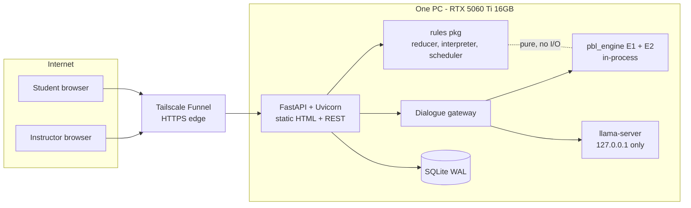

# Architecture

Source: spec sections 4, 5, 6. Read [architecture-essentials.md](architecture-essentials.md) first. Items not in the spec are **[PROPOSED]**.

## 1. System context



The backend is the **only** process that touches DB, engines and model.

## 2. Components

| Component | Responsibility | Must not |
| --- | --- | --- |
| Web (static HTML/CSS/vanilla JS modules) | Render state; send commands; poll `GET state` every 1 s; send tick with real elapsed ms | Hold rules or compute scores |
| API (FastAPI, Pydantic v2) | Auth, session, CSRF, role checks, command validation, idempotency (`client_seq`), call reducer, append events, serve state | Contain game rules (delegates to `rules`) |
| `rules` package | `apply(state, command, clock, rng) -> (state, events)`; ScrumScript interpreter; scheduler (cards, escalation, calls, delegation returns) | Do I/O, read wall clock, use global RNG |
| Store (SQLAlchemy 2, Alembic) | Persist `run_events`, `transcript_lines`, users, sessions, assessments | Be the source of state beyond event replay |
| Gateway | Event → prompt, call model, validate, fallback, log | Change state; accept student text |
| E1 | Choose memory segments fitting a token budget per stage | Touch DB |
| E2 | Process score, learning gain + bootstrap interval | Touch DB |
| llama-server | Constrained JSON chat completion | Be reachable off-box |

## 3. Process model [PROPOSED]

- One Uvicorn process (SQLite single-writer; WAL for concurrent reads). Per-run async lock so a run's commands serialise.
- In-memory cache: `run_id → (state, last_seq)`; rebuilt from `run_events` on miss/restart.
- Gateway uses a semaphore = model slots (default 4) and a queue-wait timeout of 2 s.
- Dialogue generation is **off the command path**: command returns after events are appended; the line arrives via the next state poll (spec 5.1 step 6).

## 4. Domain model

### 4.1 Run state (derived by replay) [PROPOSED shape]

```
RunState {
  run_id, seed, content_version, balance_version, status (active|ended), ending|null
  sprint: {index, stage (PLANNING|STANDUP|BUILD|REVIEW)}
  clock: {game_seconds, day, minutes_used_today}
  meters: {points, rating, cover, focus}
  pile: [Card]
  open_card: card_id|null
  work: {ticket_id, flagged_line, selected_option, runs_used, dod:{tests,matches_doc,no_security}} | null
  unlocked_concepts: set, perks_owned: set
  shipped: [{ticket_id, result, option_effect, sprint}]     # security-hole list for attack check
  repeat_counts: {behaviour: n}                              # per sprint, for x0.7
  call_misses: n, warnings: n
  standups: [{n, question_ticket_id, answer, contradiction}]
  delegated: [{card_id, returns_at, hidden_bug}]
  process_log: [behaviour events for E2]
}
Card {id, type (build|fix|help_call|problem_report|status_demand), sender, deadline_at, payoff, penalty, escalation (0..2: message|call|meeting), ticket_id|null, state (open|worked|delegated|deferred|done)}
```

### 4.2 Event types [PROPOSED]

Names are proposals; payload JSON schema lives in `content/schemas/events/`. One event per state change; commands may emit several.

`run_started, stage_advanced, tick_applied, card_spawned, card_opened, card_escalated, line_flagged, patch_selected, script_run, dod_toggled, pushed, push_blocked, meters_changed, card_delegated, delegation_returned, card_coached, card_deferred, standup_asked, standup_answered, contradiction_detected, call_rang, call_answered, call_missed, ping_sent, tutorial_watched, concept_unlocked, perk_bought, assistant_used, review_resolved, warning_issued, attack_check_resolved, run_ended`

### 4.3 Initial meters [PROPOSED, in balance.yaml, guesses]

Rating 3.5, Cover 0, Focus 100, Points 0. Must satisfy: lose at Rating < 2.0 reachable; warning at Rating < 3.0 reachable in 1 sprint.

### 4.4 Randomness [SPEC]

Seed per run. Independent streams per purpose, derived `rng_purpose = Random(hash(seed, purpose))`: `delegation_bug`, `assistant_error`, `ping_type`, plus [PROPOSED] `card_spawn`. Adding a draw in one stream never shifts another.

## 5. Command pipeline

```mermaid
sequenceDiagram
  participant B as Browser
  participant A as API
  participant R as Reducer
  participant D as DB
  participant G as Gateway
  participant M as llama-server
  B->>A: POST /commands {client_seq, command}
  A->>A: session, CSRF, role, ownership, client_seq dedupe
  A->>R: apply(state, cmd, clock, rng)
  R-->>A: (state', events) or ILLEGAL_*
  A->>D: append run_events (seq++)
  A-->>B: 200 {events, seq}
  opt events need dialogue
    A->>G: dialogue request (async)
    G->>G: E1 segments for stage
    G->>M: chat + JSON schema (≤10s)
    M-->>G: {text,tone} or timeout
    G->>G: validate; 1 retry; else fallback
    G->>D: transcript_lines (source, latency)
  end
  B->>A: GET /state?since=seq
  A-->>B: state + new events + new lines
```

Idempotency: same `client_seq` returns the stored result, never applies twice.

## 6. Rules engine

### 6.1 Reducer
Pure function. Illegal in current state → `ILLEGAL_COMMAND` (e.g. `push` with no open card). Stage jump not in E1 graph → `ILLEGAL_TRANSITION`. Opening a second card while one is open: reject, or switch with Focus penalty (spec allows either; **[PROPOSED]: switch with Focus penalty**, so a ringing call can force it).

### 6.2 Time
`tick(real_ms)`: clamp to a max per tick [PROPOSED 5,000 ms], ×160/1000 → game seconds. Actions cost in-game minutes from `balance.yaml`; if `focus < 30` multiply by 1.5. A day cannot exceed 480 minutes; overflow carries to next day or is refused [PROPOSED: refused action `ILLEGAL_COMMAND`/`DAY_FULL`; day ends via `advance_stage`/tick].

### 6.3 Push resolution (lookup, never judgement)
1. Option has `effect` label (data).
2. `crashes` → `push_blocked`, −30 pts.
3. Else result from table in essentials §B. Points × difficulty where stated, × `0.7^k` repeat factor (k = earlier identical good behaviours this sprint).
4. Unticked DoD box → +5 Cover, `process_log` entry.
5. `security_hole` → append to `shipped`; no immediate rating change.
6. `wrong_hidden` → schedule review penalties over next in-game day; viral post chance [PROPOSED: seeded draw `viral` stream].

### 6.4 Review resolution (order fixed)
reviews → posts → rating. Points tally. Toolbox opens. Rating < 3.0 → `warning_issued`. MVP: for each shipped security hole run scripted attack check → −0.8 rating, −150 points. Then evaluate lose conditions → `run_ended` with ending.

### 6.5 Scheduler
Spawns cards per sprint density (≈2 / 5 / ≥8 for sprints 1 / 4 / 7), escalates past deadline (never deletes), rings calls, returns delegations, drops pings by seeded type.

### 6.6 ScrumScript interpreter
- Lexer + parser for allowed keywords per sprint; sprint 1: `function return if else = ==`.
- Evaluates a ticket's doc examples (5 runs) against the chosen line/option applied to the source.
- Step limit (fixed in `balance.yaml`); exceeds → treated as runtime error.
- No imports, no I/O, no host object access. Output: per-run `{input, expected, actual|error, pass}` → plain English.
- Security-hole tickets: a **data flag** (`option.effect = security_hole`), not detected by analysis; Run Script passes on normal input (CODE-3). Security Scan perk (post-MVP) reads the flag.
- Property tests: any generated program terminates within the step limit, never raises unhandled.

## 7. Dialogue gateway

See [trd.md §5](trd.md) and [agent-spec.md Part B](agent-spec.md). Pipeline: structured event → persona + E1 segments → model (schema-constrained) → validate (length ≤ 40 words, no correct-patch text, no other teammate's secret) → 1 retry → fallback. Logged with model, prompt tokens, latency, source.

## 8. Persistence

| Table | Columns |
| --- | --- |
| users | id, email, display_name, password_hash, role, cohort_id, consent_at |
| sessions | id_hash, user_id, created_at, last_seen_at, expires_at |
| runs | id, user_id, seed, content_version, balance_version, status, ending |
| run_events | run_id, seq, game_time, type, payload JSON (append-only; PK run_id+seq) |
| transcript_lines | run_id, seq, speaker, text, source (llm/fallback), latency_ms |
| assessments | id, user_id, kind (pre/post), score, max_score |
| auth_events | id, user_id, kind, ip_hash, created_at |

Append-only enforced by [PROPOSED] DB trigger rejecting UPDATE/DELETE on `run_events`. Cohort table [PROPOSED]: `cohorts(id, name, instructor_id)`; spec only has `cohort_id` on users.

Replay: `state = fold(apply, initial(seed, content, balance), events)`. Event payloads must be sufficient to replay **without** re-drawing RNG (store drawn outcomes) [PROPOSED] so content changes don't rewrite history; run pins `content_version` + `balance_version`.

## 9. Content pipeline

Files: `content/tickets/*.json`, `tutorials/*.json`, `teammates/*.json`, `balance.yaml`; schemas in `content/schemas/`. CI validates; golden-output tests run every option of every ticket through the interpreter. Exactly one `correct` option per ticket. Each wrong option has a named bug type (the five bug kinds map to the effect labels + wrong-result, runtime error, security hole, etc.).

## 10. Security architecture

| Boundary | Control |
| --- | --- |
| Internet → PC | Tailscale edge, login, rate limits, CSRF, CSP |
| Backend → model | localhost only, per-user quota (20/min), fixed slots, timeout |
| Backend → engines | in-process, solve() limits |
| Backend → DB | parameterised SQL; only backend holds path |

Details in [trd.md §7](trd.md). Funnel exposes only the app port; `/internal/*` and instructor/admin routes need tailnet-only path or instructor role.

## 11. Failure modes

| Failure | Behaviour |
| --- | --- |
| Model down/slow/invalid | Fallback line, `source=fallback`; game continues (TEAM-1) |
| Process restart | Rebuild state from `run_events`; clients resume with `since=seq` |
| Duplicate command (retry) | Same result via `client_seq` |
| Illegal command | RFC 9457 problem, `ILLEGAL_COMMAND` / `ILLEGAL_TRANSITION`; no events written |
| DB locked | Short busy timeout + retry; 503 problem if exceeded |
| PC sleeps/reboots | Services auto-start; health check before session; disable sleep |
| Tailscale outage | Site outage (accepted) |
| VRAM short | Drop to 3 slots, shorten context |

## 12. Observability [PROPOSED]

Structured JSON logs (no passwords, no raw emails: use `ip_hash`); `/healthz`; `/api/v1/model/status` (queue depth, last latency); per-call dialogue log in `transcript_lines`.

## 13. Capacity

utilisation = calls/s × s/call ÷ slots. 10 students × 1 call / 30 s = 0.33/s × 3 s ÷ 4 = ≈ 25%; 3× rate ≈ 75%. Estimate; confirm in M0 and load test.
