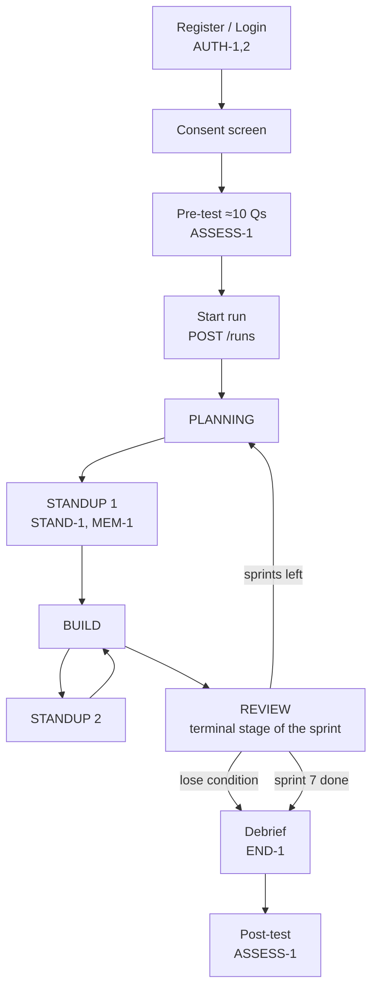
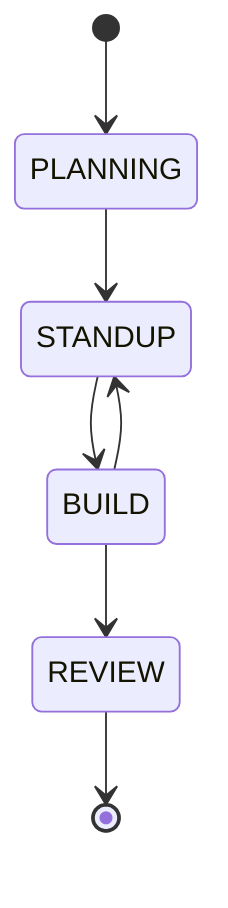
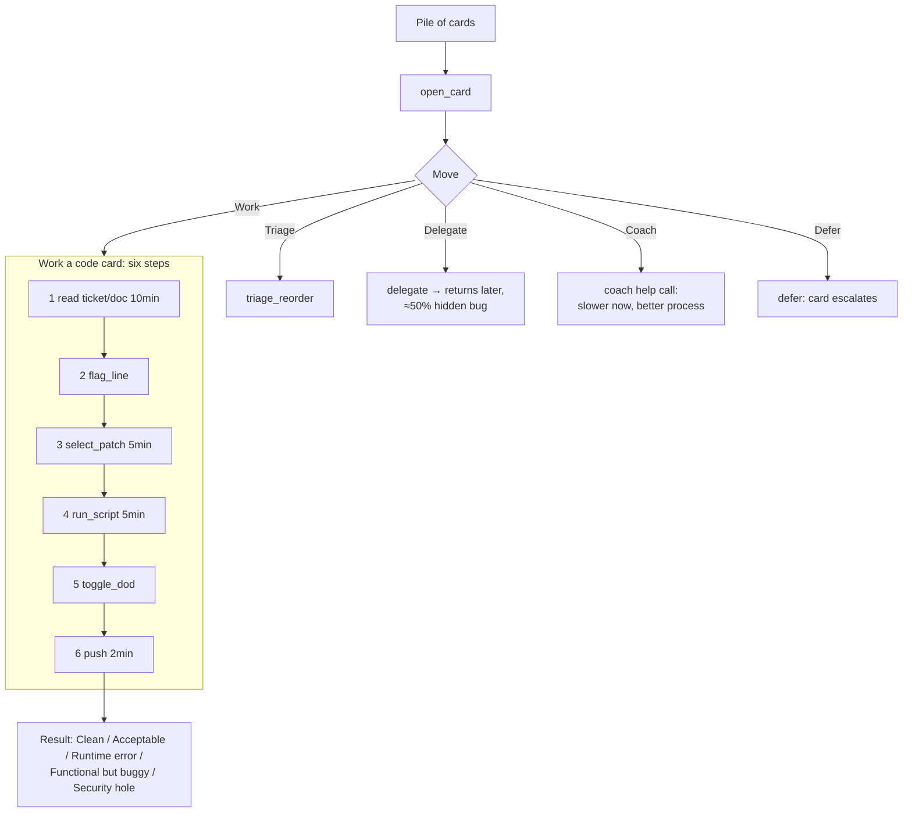

# User Flow

Source: spec section 3. Diagrams are Mermaid.

## 1. Student session

A student logs in, consents, takes the pre-test, then plays sprints of Planning → Standup → Build → Standup → Review until sprints run out or a lose condition fires.



Stage graph is E1's, [SPEC] 6.4: PLANNING→STANDUP→BUILD; BUILD→STANDUP or →REVIEW; REVIEW terminal. Any other jump returns `ILLEGAL_TRANSITION`. Allowed edges only:



> REVIEW is terminal **per sprint**. How a new sprint restarts at PLANNING (new E1 stage machine per sprint vs reset) is **[OPEN]**; MVP has one sprint so it does not matter yet.

## 2. Inside BUILD: working a card

The student picks one card from the Pile and chooses one of five moves.



Step names are [PROPOSED] labels for the "six-step sequence ending in a push" (spec does not name them). Fix tickets use flag_line + select_patch; Build tickets fill a blank from a tray (select_patch).

## 3. Event flows

| Flow | Steps | Req |
| --- | --- | --- |
| Standup question | Teammate asks about last push → student picks accurate (only if concept unlocked) / vague / wrong → Cover −10 / +5 / +15 → answer stored as memory | STAND-1, MEM-1 |
| Ringing call | Call pops over current card with timer; answer for 15 in-game min and sometimes get a clue, or ignore; 3rd missed call adds 3 Cover | PILE-3, METER-1 |
| Ping | Clue, noise or trap arrives in TeamChat; trap ("just push it") tempts skipping DoD | CODE-4 |
| Delegate | Card leaves student, returns later, ≈ half carry hidden bug needing review | PILE-4 |
| Coach | Help call answered by teaching the fix: slower now, fewer calls later, higher process score | PROC-1 |
| Review | Reviews, then posts, then rating resolve in that order; points tally; Toolbox opens; Rating < 3.0 gives warning | METER-1, METER-2 |
| Instructor | Log in → open cohort → see runs with process scores → open transcript | INSTR-1 |
| Hacker event (post-MVP) | Alert, attack meter, patch waves with Refresh, review each patch, encourage teammate | HACK-1 |

### Standup + memory

```mermaid
sequenceDiagram
  participant S as Student
  participant B as Backend
  participant E1 as E1 memory
  participant M as Model/fallback
  B->>E1: segments for STANDUP within budget
  B->>M: question prompt (persona + memory)
  M-->>B: {text,tone} or fallback
  B-->>S: teammate asks about last push
  S->>B: reply_standup(accurate|vague|wrong)
  B->>B: Cover -10/+5/+15; contradiction? +10 once
  B->>E1: store answer as memory segment
```

### Review resolution order

1. Reviews, 2. posts, 3. rating (in that order). Points tally. Toolbox opens. Rating < 3.0 → demotion warning. Shipped security hole → scripted attack check (MVP): −0.8 rating, −150 points.

## 4. Instructor flow


Other cohorts return 403/404 (INSTR-1).

## 5. Lose endings

Four endings [SPEC: END-1 "all four endings"]. Three lose causes are named (Rating < 2.0, Cover 100, two demotion warnings) plus the win ending after sprint 7 = four. Exact ending identifiers are [PROPOSED]: `win`, `lose_rating`, `lose_cover`, `lose_warnings`.
